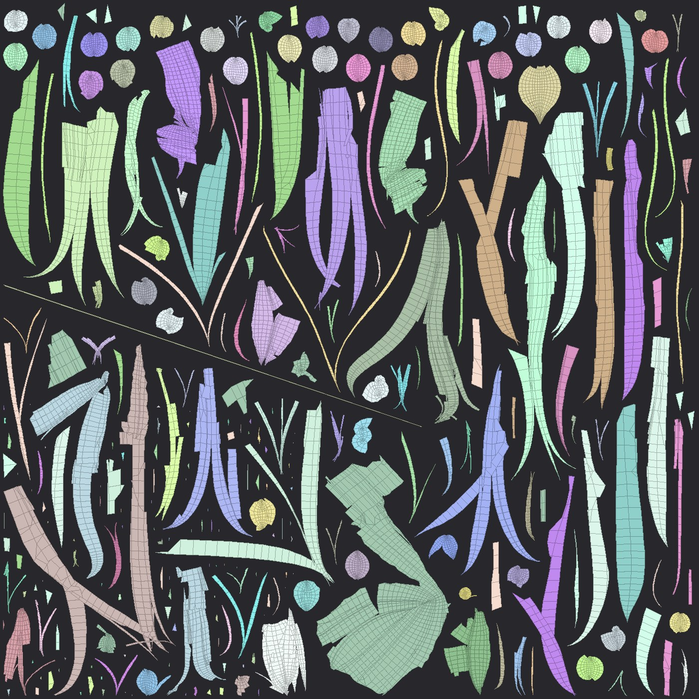

# Kanzashi

[日本語](README.md) | English

A Blender tool that splits a generated hair mesh into strands, lets you fix the split by painting, bends each strand by a wire, and makes a UV map with one island per strand.
It is made for hair that comes out of 3D generation services such as Tripo as one fused lump.

- Version: 0.2.0 (prototype). This repository is private.
- Tested with: Blender 5.3.0 on Windows 11. Other versions are untested.
- Author: Lida
- Panel languages: Japanese and English (see "Language" below).



## What it does

| Step | What happens |
|---|---|
| 1 Choose the hair | Registers the hair meshes automatically from object and material names. You can add and remove meshes |
| 2 Detect the strands | Follows rings of equal distance from the crown, splits the hair into strands and gives each one a colour and a wire |
| 3 Fix wrong colours | Pick a colour with the eyedropper and paint faces with the brush: the painted faces move to the strand of that colour. Ctrl+Z works |
| 4 Bend the hair by wires | Click a strand to get handles on its wire. Move a handle and the strand bends (the first 5 cm at the root stay put) |
| 5 UV per strand | One island per strand, packed into 0-1. Check, export for texturing (FBX / GLB), swap (transfers the current textures to the new UV), revert |
| 6 Finish | Put the view back / write the bent shape into the mesh and remove the setup |

## Install (add-on)

1. Get `Kanzashi-addon-0.2.0.zip` (`python tools/build_packages.py` makes it in `dist/`).
2. In Blender, open Edit > Preferences > Add-ons, choose "Install from Disk" in the menu at the top right, and pick the ZIP.
3. Enable "Kanzashi".
4. Open the sidebar of the 3D viewport (N key). There is a "Kanzashi" tab.

To try it without installing, start Blender like this; the panel is there for that session only.

```bash
blender model.blend --python kanzashi/panel.py
```

## Language

The menu at the top of the panel chooses the language: **Auto** (follows Blender's interface language: Japanese when Blender is in Japanese, English otherwise), **日本語**, or **English**.
The choice is remembered in `kanzashi.json` in Blender's config folder.
The panel changes at once. A few texts that Blender reads only when the add-on is registered (names in the undo history, the name of the tool) change the next time Blender starts.

## Order of work

**Always work in a copy of your model file.** The detection cuts the mesh along the strand borders (the vertex count grows).

1. Press "Auto register" in step 1. Remove wrong entries with the X.
2. Press "Detect strands" in step 2. The hair is shown in one colour per strand.
3. Where a colour is wrong, press "Start Fixing Colours" in step 3. Click a face of the right colour with the eyedropper, then stroke over the faces to fix with the brush.
4. To bend a strand, show its handles in step 4 and move them (G key).
5. Press "Make the Strand UV" in step 5. It takes tens of seconds. The result of the check is shown below the button.
6. To make new textures, use "Export for Texturing". To keep the current look on the new UV, use "Swap to this UV".

When you come back to edit more, **do not detect again**; go to step 3. A second detection rebuilds everything, and your repainting and bending are lost.

### Controls

| Control | What it does |
|---|---|
| Click / stroke | Eyedropper, brush, or "2 colours" (switch in the panel) |
| Ctrl+click | Always the eyedropper |
| Shift+click | Shows only that colour and the current one |
| `[` and `]` | Brush size |
| Ctrl+Z / Ctrl+Shift+Z | Undo / redo |
| Esc | Leaves the current mode |

The brush paints whole faces, so the size of the faces is the finest detail you can paint.

## Without the panel (script)

Unpack `Kanzashi-scripts-0.2.0.zip` and run it in the background. The opened file is not saved. It stops if the output already exists.

```bash
blender -b model.blend --python kanzashi_run.py -- --out model_kanzashi.blend --export hair.fbx --report report.json
```

| Argument | Meaning |
|---|---|
| `--hair NAME` | Name of a hair mesh (repeatable). Without it, the meshes are found by object and material names |
| `--out` | The new .blend the result is saved to |
| `--export` | FBX / GLB of the hair with only the strand UV |
| `--report` | JSON report |
| `--cap-len` | Rings longer than this are treated as "fused" (m, default 0.40) |
| `--no-uv` | Only split into strands |

Repainting, bending and swapping are functions of the panel (the add-on).

## What the check looks at

- Whether the UV is inside 0-1.
- Whether islands overlap, and whether there are at least 2 px between islands (for a 2048 px image).
- Whether the faces that fold over or are squashed inside an island are 2 % of the surface or less. Above that, exporting and swapping are refused.
- After a swap, the colour before and after is compared per triangle, and the number of triangles that differ is reported.

## Known limits

- This is a prototype, tested with Blender 5.3 only.
- With flat sheet-like bangs, thin faces, or shapes that do not unfold well, the detection gets coarse or the UV gets many islands.
- The wire of a branch does not follow the wire of its parent.
- Repaint before you bend. Repainting after bending moves faces to the wrong place.
- A swap transfers only images that are read through a UV (not MatCap and the like). It is meant to keep the current look; the finish is expected to be new textures made on the new UV.
- Whether a 3D generation service keeps the UV of the model you bring in depends on the service's settings. Check that the UV of the model you get back is the same.
- While the add-on is enabled, its key settings are added to left click and Esc in Object Mode (they pass through when you are not bending).
- The interface does not respond during the slow steps. There is no cancel button.

## Contents

```
kanzashi/            the add-on (panel.py, the modules lida_hair_*.py, the two languages lida_hair_i18n.py)
scripts/             the script that runs without the panel
tools/               makes the ZIP packages; checks that every panel text has an English one
docs/                figure
```

No models or textures are included.

## Licence

The code is GPL-3.0-or-later ([LICENSE](LICENSE)), because it is Python that uses Blender's API.
Copyright (c) 2026 Lida
