# Kanzashi

[日本語](README.md) | English

<p align="center"><picture><source media="(prefers-color-scheme: dark)" srcset="docs/kanzashi_logo_dark.png">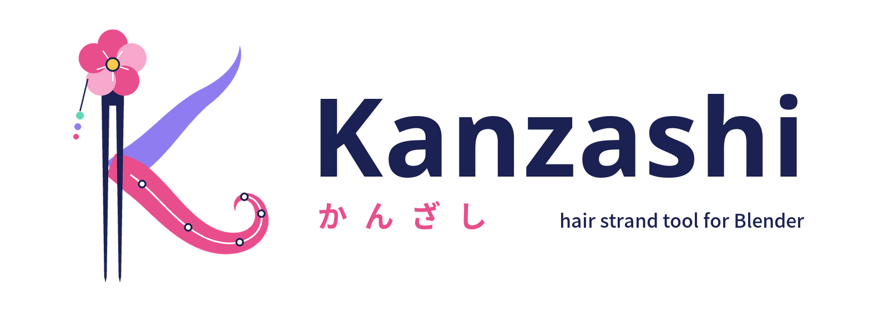</picture></p>

<p align="center"><picture><source media="(prefers-color-scheme: dark)" srcset="docs/lida_logo_dark.png"></picture>&nbsp;&nbsp;&nbsp;<b>×</b>&nbsp;&nbsp;&nbsp;<a href="https://www.tripo3d.ai/"><picture><source media="(prefers-color-scheme: dark)" srcset="docs/tripo_logo_dark.png"></picture></a></p>
<p align="center"><b>Lida × Tripo official collaboration</b></p>

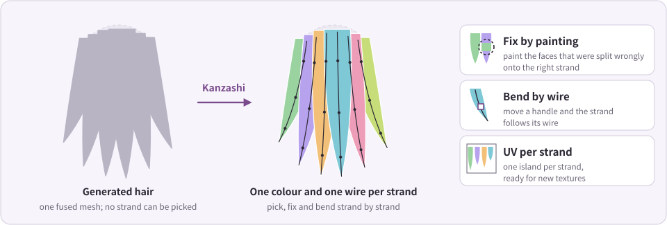

Kanzashi is a Blender add-on that lets you work on a generated hair mesh strand by strand.
It splits the hair into strands, lets you fix the split by painting, bends each strand by a wire, and makes a UV map with one island per strand.

- Version: 0.4.2
- Tested with: Blender 5.3.0 on Windows 11. Other versions are untested.
- Author: Lida
- Lida × Tripo official collaboration
- Panel languages: Japanese and English (see "Language" below).

## What kind of add-on it is

Hair that comes out of 3D generation services such as Tripo is usually one mesh with everything fused together. As it is, these things are hard:

- Selecting or moving a single strand, for example moving only the strand that runs into an arm.
- Fixing the flow of the hair strand by strand.
- Making the texture again, because the UV does not follow the shape of the strands.

Kanzashi splits that hair into strands and gives each strand a **colour** and a **wire**.

- The colour shows which faces belong to which strand. Where the split is wrong, paint the faces and they move to the right strand.
- The wire is a line through the middle of the strand. Move a handle on the wire and the strand bends along it.
- When the split is right, it makes a UV map in which each strand is one island.

Real hair after detection and repainting (left: the whole hair from behind; right: a close view of the crown). One colour is one strand.

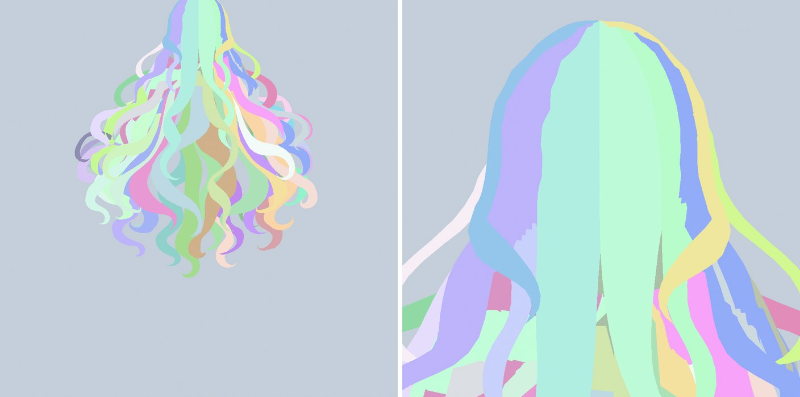

It is meant for hair fused into one lump (one mesh, or a few). Do not use it on hair that is already separate strand parts, or on hair made of hair cards only.

## What it does

The panel has six steps, used from the top down.

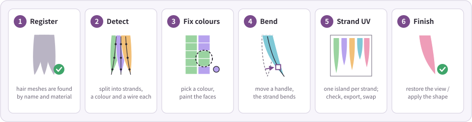

The Blender window: the six steps are in the "Kanzashi" tab of the sidebar on the right (a hair that is already detected; the black lines are the wires). The screenshot shows the panel in Japanese; it can be switched to English.

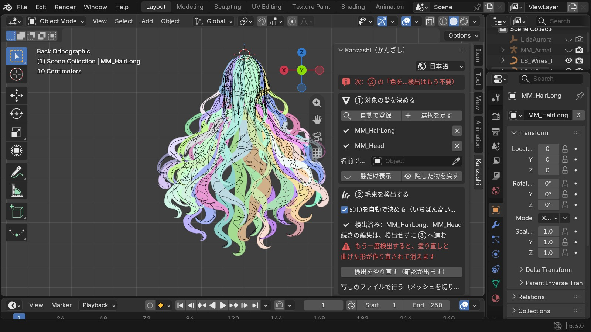

| Step | What happens |
|---|---|
| 1 Choose the hair | Registers the hair meshes automatically from object and material names. You can add and remove meshes |
| 2 Detect the strands | Follows rings of equal distance from the crown, splits the hair into strands and gives each one a colour and a wire |
| 3 Fix wrong colours | Pick a colour with the eyedropper and paint faces with the brush: the painted faces move to the strand of that colour. Ctrl+Z works |
| 4 Bend the hair by wires | Click a strand to get handles on its wire. Move a handle and the strand bends (the first 5 cm at the root stay put) |
| 5 UV per strand | One island per strand, packed into 0-1. Check, export for texturing (FBX / GLB), swap (transfers the current textures to the new UV), revert |
| 6 Finish | Put the view back / write the bent shape into the mesh and remove the setup |

### Fixing by painting, bending by wire

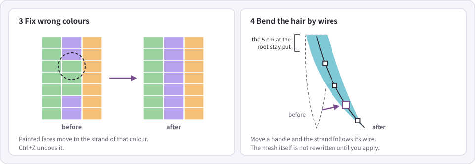

One strand (orange) of real hair bent by its wire. From the left: before, after moving the handle at the tip by 10 cm, after moving a handle in the middle by 5 cm. The other strands do not move.

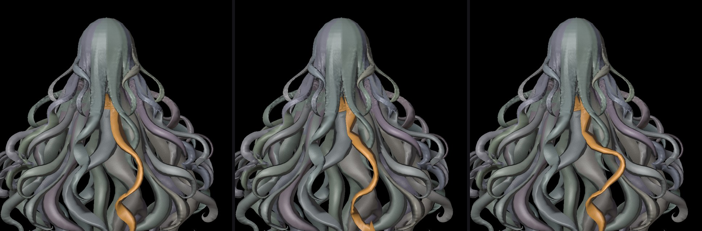

- The detection is automatic, so one lock may be cut into two colours, or two locks joined in one. You look at those places and repaint them.
- Bending does not rewrite the mesh at once. Until you apply the shape in step 6, you can bend again as often as you like.

### UV per strand

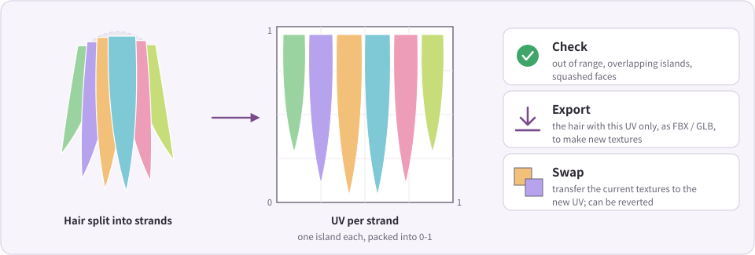

An example made from real hair (the islands are in the strand colours):


### Place in the pipeline, and three ways to use it

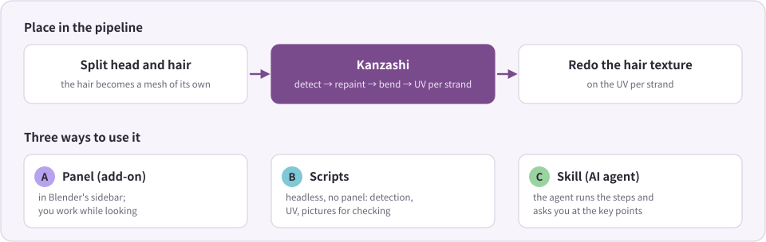

| Way | Good for | Read |
|---|---|---|
| A Panel (add-on) | painting and bending in Blender while you look | "Install (add-on)", "Order of work" |
| B Scripts | detection and UV in one go, without the panel | "Without the panel (script)" |
| C Skill (AI agent) | leaving the hair to an agent and confirming only the key points yourself | "Use by an agent (skill)" |

When an agent uses it, there is also a script that finds and fixes strands running into the body or the arms (it is not part of the add-on).

## Where it is distributed and what each place has

| What | BOOTH | GitHub |
|---|---|---|
| The add-on (install in Blender, use the panel) `Kanzashi-addon-0.4.2.zip` | yes | yes ([Release](https://github.com/Lida-V/Kanzashi/releases)) |
| The scripts that run without the panel `Kanzashi-scripts-0.4.2.zip` | no | yes ([Release](https://github.com/Lida-V/Kanzashi/releases)) |
| The skill for agents (`skills/kanzashi/`, with the script that finds and fixes buried strands) | no | yes (in this repository only) |

- BOOTH (free): https://lidamidorin.booth.pm/items/9167843 . Only the add-on is there.
- The scripts and the skill are on GitHub only.

## Install (add-on)

1. Get `Kanzashi-addon-0.4.2.zip` (from BOOTH or the GitHub Release; `python tools/build_packages.py` also makes it in `dist/`).
2. In Blender, open Edit > Preferences > Add-ons, choose "Install from Disk" in the menu at the top right, and pick the ZIP (it is installed as an extension).
3. Enable "Kanzashi".
4. Open the sidebar of the 3D viewport (N key). There is a "Kanzashi" tab.

To try it without installing, start Blender like this; the panel is there for that session only.

```bash
blender model.blend --python scripts/kanzashi_panel.py
```

## Use by an agent (skill)

When an AI agent reads this repository, [AGENTS.md](AGENTS.md) leads it to [skills/kanzashi/SKILL.en.md](skills/kanzashi/SKILL.en.md), and it handles the hair like this:

1. Checks whether the add-on is installed and, if not, asks the user whether it may install it (`tools/install_addon.py`).
2. Detects the strands and makes the UV without the panel, saving to a new file (`scripts/kanzashi_run.py`).
3. Makes pictures in strand colours and lets the user judge the split (`scripts/kanzashi_preview.py`).
4. Where something needs fixing, the user paints and bends in the Blender panel; the agent goes on from the saved file and makes the UV again.
5. Checks whether strands go into the body and, if so, asks the user: "I fix them myself / fix them by the AI's plan / leave them" (`skills/kanzashi/scripts/hair_penetration.py`; this calculation is not in the add-on).
6. Asks the user before deciding what the UV is for (export / swap / just add) and before applying the shape.

## Language

The menu at the top of the panel chooses the language: **Auto** (follows Blender's interface language: Japanese when Blender is in Japanese, English otherwise), **日本語**, or **English**.
The choice is remembered in `kanzashi.json` in Blender's config folder.
The panel changes at once. A few texts that Blender reads only when the add-on is registered (names in the undo history, the name of the tool) change the next time Blender starts.

## Order of work

Within the making of a character, do this **after the head and the hair are split into separate parts and before the textures are redone** (a texture made for the old UV cannot be used as it is once the strand UV exists).

**Always work in a copy of your model file.** The detection cuts the mesh along the strand borders (the vertex count grows).

1. Press "Auto register" in step 1. Remove wrong entries with the X.
2. Press "Detect strands" in step 2. The hair is shown in one colour per strand.
3. Where a colour is wrong, press "Start Fixing Colours" in step 3. Click a face of the right colour with the eyedropper, then stroke over the faces to fix with the brush.
4. To bend a strand, show its handles in step 4 and move them (G key).
5. Press "Make the Strand UV" in step 5. It takes tens of seconds. The result of the check is shown below the button.
6. When you are done, press "Close the Tool" in step 6.

The top of the panel tells you in red what to press next. Below are the screens of each step (left: the 3D view, right: the box of that step in the panel).

### 1 Choose the hair

"Auto register" looks for the hair meshes by object and material names and puts them in the list.

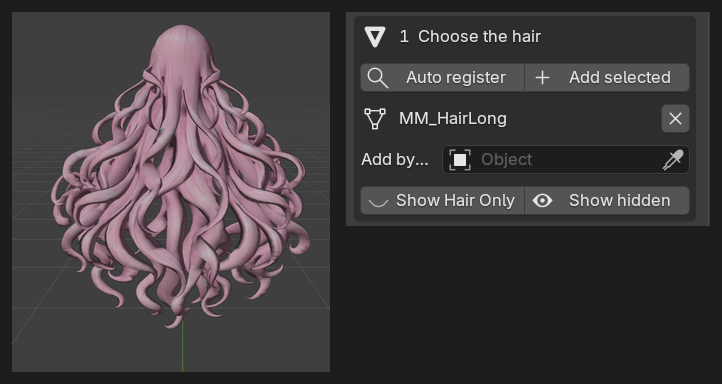

- Remove a wrong entry with the X at the right of its row.
- For hair that was not found, select it in the 3D view and press "Add selected", or choose it in the "Add by name" field.
- "Show Hair Only" hides everything else; "Show hidden" brings it back.

### 2 Detect the strands

"Detect strands" shows the hair in one colour per strand and gives each strand a wire (the black lines).

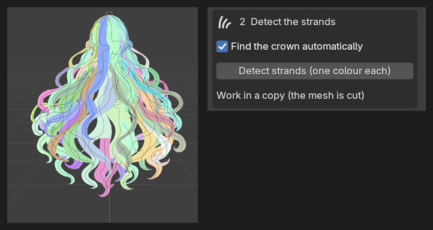

- The crown is the highest point by default. Clear the checkbox to use the 3D cursor instead.
- Detect only once. Afterwards the button reads "Detect again"; a second detection throws away your repainting and bending.

### 3 Fix wrong colours

Press "Start Fixing Colours". Click a face of the right colour with the eyedropper, then stroke over the faces to fix with the brush: they move to the strand of that colour.

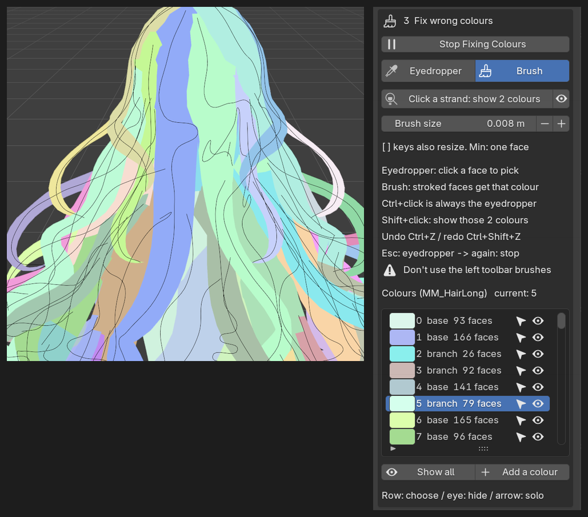

- "Click a strand: show 2 colours" keeps only the current colour and the one you click, and hides the rest.
- Click a row of the colour list to choose that colour. The eye hides it, the arrow shows it alone.
- "Add a colour" makes a new strand.
- Press "Stop Fixing Colours" when you are done.

### 4 Bend the hair by wires

Press "Show Handles and Bend", then click a face of the strand to bend. Round handles appear on its wire. Click a handle and move it with G; the strand follows the wire.

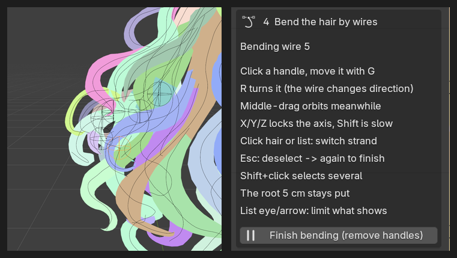

- R rotates. X, Y, Z lock an axis; Shift moves slowly.
- The first 5 cm at the root stay put; the rest bends.
- Press "Finish bending" when you are done. Until you apply the shape in step 6, you can bend again as often as you like.

### 5 UV per strand

Press "Make the Strand UV". It takes tens of seconds. The result of the check is shown below.

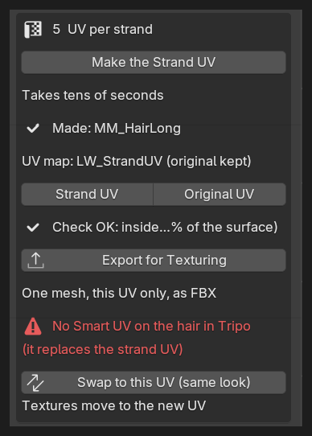

- The UV map is called `LW_StrandUV`. The original UV is kept; switch with "Strand UV" and "Original UV".
- To make new textures, use "Export for Texturing". **When texturing in Tripo, do not use Smart UV on the hair** (it makes a new UV and the strand UV is lost; keep the original UV).
- To keep the current look on the new UV, use "Swap to this UV".

### 6 Finish

"Close the Tool" puts the view back. The wires stay, so you can continue later.

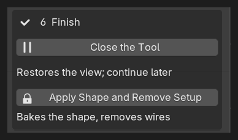

- "Apply Shape and Remove Setup" writes the bent shape into the mesh and removes the wires. After that you cannot bend again.

The screens are from 0.4.1 (0.4.2 differs only in the panel title). The hair in the pictures is an example and is not in the repository.

When you come back to edit more, **do not detect again**; go to step 3. A second detection rebuilds everything, and your repainting and bending are lost.

### Controls

| Control | What it does |
|---|---|
| Click / stroke | Eyedropper, brush, or "2 colours" (switch in the panel) |
| Ctrl+click | Always the eyedropper |
| Shift+click | Shows only that colour and the current one |
| `[` and `]` | Brush size |
| Ctrl+Z / Ctrl+Shift+Z | Undo / redo |
| Esc | Leaves the current mode |

The brush paints whole faces, so the size of the faces is the finest detail you can paint.

## Without the panel (script)

Unpack `Kanzashi-scripts-0.4.2.zip` and run it in the background. The opened file is not saved. It stops if the output already exists.

```bash
blender -b model.blend --python kanzashi_run.py -- --out model_kanzashi.blend --export hair.fbx --report report.json
```

| Argument | Meaning |
|---|---|
| `--hair NAME` | Name of a hair mesh (repeatable). Without it, the meshes are found by object and material names |
| `--out` | The new .blend the result is saved to |
| `--export` | FBX / GLB of the hair with only the strand UV |
| `--report` | JSON report |
| `--cap-len` | Rings longer than this are treated as "fused" (m, default 0.40) |
| `--no-uv` | Only split into strands |
| `--swap` | Transfers the current textures to the new UV and draws the hair with the strand UV |
| `--apply` | Writes the bent shape into the mesh and removes the wires |
| `--redetect` | Detects again even on detected hair (repainting and bending are lost) |

Given a hair that is already detected (also one repainted or bent in the panel), the strands are kept and only the UV is made again. Repainting and bending are functions of the panel (the add-on).

Pictures in strand colours (front, back, left, right, and the UV):

```bash
blender -b model_kanzashi.blend --python kanzashi_preview.py -- --out-dir preview
```

## What the check looks at

- Whether the UV is inside 0-1.
- Whether islands overlap, and whether there are at least 2 px between islands (for a 2048 px image).
- Whether the faces that fold over or are squashed inside an island are 2 % of the surface or less. Above that, exporting and swapping are refused.
- After a swap, the colour before and after is compared per triangle, and the number of triangles that differ is reported.

## Known limits

- Tested with Blender 5.3 only.
- With flat sheet-like bangs, thin faces, or shapes that do not unfold well, the detection gets coarse or the UV gets many islands.
- The wire of a branch does not follow the wire of its parent.
- Repaint before you bend. Repainting after bending moves faces to the wrong place.
- A swap transfers only images that are read through a UV (not MatCap and the like). It is meant to keep the current look; the finish is expected to be new textures made on the new UV.
- Whether a 3D generation service keeps the UV of the model you bring in depends on the service's settings. Check that the UV of the model you get back is the same.
- While the add-on is enabled, its key settings are added to left click and Esc in Object Mode (they pass through when you are not bending).
- The interface does not respond during the slow steps. There is no cancel button.

## Contents

```
kanzashi/            the add-on
skills/kanzashi/     the skill for agents (SKILL.md in Japanese, SKILL.en.md in English) and its script that finds and fixes buried strands
scripts/             scripts that run without the panel (detection and UV, pictures for checking, the check of the UV mark, panel without installing)
tools/               makes the ZIP packages; installs the add-on or tells whether it is installed
docs/                the logo, and the figures and pictures of the README
```

No models or textures are included. Notes for people changing the code (tests, rules) are in [AGENTS.md](AGENTS.md).

## Licence

The code is GPL-3.0-or-later ([LICENSE](LICENSE)), because it is Python that uses Blender's API.
Copyright (c) 2026 Lida
