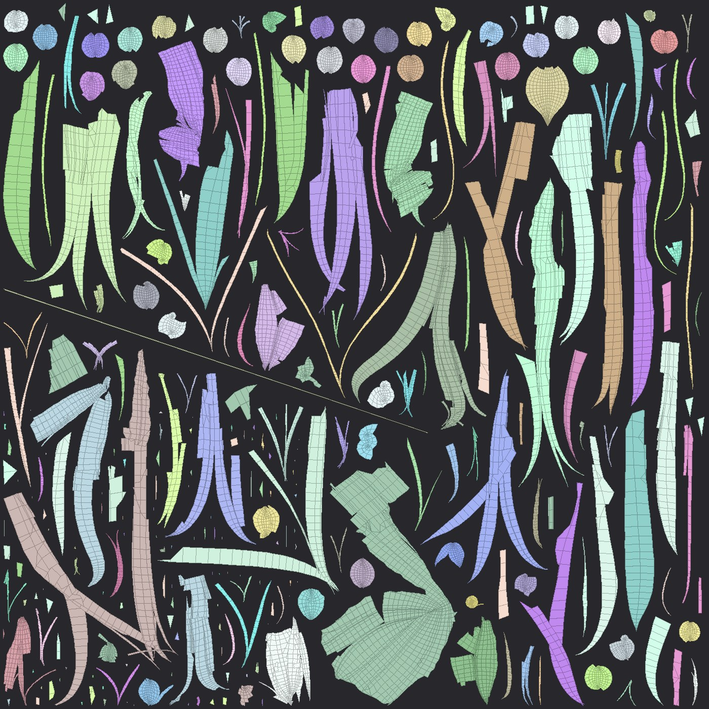

# Kanzashi（かんざし）

日本語 | [English](README.en.md)

生成した髪のメッシュを毛束ごとに分け、塗って直し、ワイヤーで曲げ、毛束ごとの UV まで作る Blender のツールです。
Tripo などの 3D 生成サービスで作った、ひとかたまりの髪を扱いやすくするために作っています。

**Kanzashi — hair strand tool for Blender**: splits an AI-generated hair mesh into strands, lets you fix the split by painting, bends each strand by a wire, and makes a UV map per strand (check, export for texturing, swap).

- 版：0.2.0（試作）。非公開のリポジトリです。
- 確かめた環境：Blender 5.3.0、Windows 11。ほかの版では試していません。
- 作者：Lida
- パネルの言語：日本語と英語（下の「言語」）



## できること

| 段 | 内容 |
|---|---|
| ① 対象の髪を決める | 髪のメッシュを名前と材質から自動で登録。足す・外すもできます |
| ② 毛束を検出する | 頭頂からの距離の輪をたどって毛束に分け、1 本ごとに色とワイヤーを付けます |
| ③ 色の違う所を直す | スポイトで色を拾い、ブラシで面を塗ると、その面が塗った色の毛束に付け替わります。Ctrl+Z で戻せます |
| ④ ワイヤーで髪を曲げる | 毛束をクリックするとつまみが出ます。つまみを動かすと毛束が曲がります（根元の 5 cm は動きません） |
| ⑤ 毛束ごとの UV | 毛束ごとに島を作って 0〜1 に詰めます。検査、テクスチャ用の書き出し（FBX／GLB）、張り替え（今のテクスチャを新しい UV へ写す）、元に戻す |
| ⑥ 終わる | 表示を元に戻す／曲げた形をメッシュに書き込んで仕組みを外す |

## 入れ方（アドオン）

1. `Kanzashi-addon-0.2.0.zip` を用意します（`python tools/build_packages.py` で `dist/` に出来ます）。
2. Blender の「編集 > プリファレンス > アドオン」の右上のメニューから「ディスクからインストール」を選び、ZIP を指定します。
3. 「Kanzashi」を有効にします。
4. 3D ビューでサイドバー（N キー）を開くと、「Kanzashi」のタブがあります。

入れずに試すだけなら、次のように起動すると、そのときだけパネルが出ます。

```bash
blender model.blend --python kanzashi/panel.py
```

## 言語

パネルのいちばん上の欄で言語を選べます。**Auto / 自動**（Blender の表示言語に合わせる。Blender が日本語なら日本語、ほかは英語）、**日本語**、**English**。
選んだ言語は、Blender の設定フォルダの `kanzashi.json` に覚えます。
パネルの文字はその場で変わります。Blender がアドオンの登録のときにだけ読む文字（元に戻す履歴に出る名前、ツールの名前）は、次に Blender を起動したときに変わります。

## 使う順番

**必ずモデルの写しのファイルで行ってください。** 検出は、毛束の境でメッシュを切ります（頂点が増えます）。

1. ① の「自動で登録」を押す。違う物が入ったら × で外します。
2. ② の「毛束を検出」を押す。髪が毛束ごとの色になります。
3. 色が違う所があれば、③ の「色を直すモードに入る」。スポイトで正しい色の面をクリックし、ブラシで直したい面をなぞります。
4. 曲げたい毛束があれば、④ でつまみを出して動かします（G キー）。
5. ⑤ の「毛束ごとの UV を作る」。数十秒かかります。下に検査の結果が出ます。
6. テクスチャを作り直すなら「テクスチャ用に書き出す」。今の見た目のまま新しい UV に替えるなら「この UV に張り替える」。

続きの編集をするときは、**検出をやり直さず** ③ へ進みます。もう一度検出すると、塗り直しと曲げた形は作り直されて消えます。

### 操作

| 操作 | 働き |
|---|---|
| クリック／なぞる | スポイト・ブラシ・2 色だけ表示（パネルで切り替え） |
| Ctrl+クリック | いつでもスポイト |
| Shift+クリック | その色と今の色だけを表示 |
| `[` と `]` | ブラシの太さ |
| Ctrl+Z ／ Ctrl+Shift+Z | 戻す／やり直す |
| Esc | 今のモードを抜ける |

## パネルなしで動かす（スクリプト）

`Kanzashi-scripts-0.2.0.zip` を展開して、背景実行で使います。開いたファイルは保存しません。出力先がすでにあると止まります。

```bash
blender -b model.blend --python kanzashi_run.py -- --out model_kanzashi.blend --export hair.fbx --report report.json
```

| 引数 | 内容 |
|---|---|
| `--hair 名前` | 髪のメッシュの名前（繰り返せます）。省くと名前と材質から探します |
| `--out` | 結果を保存する新しい .blend |
| `--export` | 毛束ごとの UV だけを持たせた髪の FBX／GLB |
| `--report` | 結果の JSON |
| `--cap-len` | これより長い輪を「溶け合った所」と見なす長さ（m、既定 0.40） |
| `--no-uv` | 毛束に分けるだけ |

塗って直す・曲げる・張り替えるは、パネル（アドオン）の側の機能です。

## 検査で見ている物

- UV が 0〜1 の中にあるか。
- 島どうしが重なっていないか、島の間が 2 px 以上あるか（2048 px の画像で）。
- 島の中で重なる面と、つぶれた面が、表面の 2 % 以下か。超えると、書き出しと張り替えを止めます。
- 張り替えの後に、三角形ごとに元の色と写した後の色を比べ、違う数を出します。

## 分かっている限界

- 試作です。Blender 5.3 でしか試していません。
- 板のような前髪や、細い面・平らに開きにくい形が多い髪では、検出が粗くなったり、UV の島が多くなったりします。
- 枝分かれした毛束のワイヤーは、親のワイヤーに付いて動きません。
- 塗り直しは曲げる前に行ってください。曲げた後に塗り直すと、付け替えがずれます。
- 張り替えで写す画像は、UV で読む画像だけです（MatCap などは写しません）。写しは今の見た目を保つための物で、仕上げは新しい UV でテクスチャを作り直す前提です。
- 3D 生成サービスが、持ち込んだモデルの UV をそのまま使ってテクスチャを作るかは、サービスの設定によります。戻ってきたモデルの UV が同じかを確かめてください。
- アドオンを有効にしている間、オブジェクトモードの左クリックとEscに、このツールのキー設定が足されます（曲げるモードでない時は素通りします）。
- 処理中は画面の操作を受け付けません。途中で止めるボタンはありません。

## 中身

```
kanzashi/            アドオン（パネル panel.py、計算のモジュール lida_hair_*.py、日英の文 lida_hair_i18n.py）
scripts/             パネルなしで動かすスクリプト
tools/               配布用の ZIP を作るスクリプト、英語の文の抜けを調べるスクリプト
docs/                図
```

モデル・テクスチャは入っていません。

## ライセンス

コードは GPL-3.0-or-later です（[LICENSE](LICENSE)）。Blender の機能を使う Python のためです。
Copyright (c) 2026 Lida
